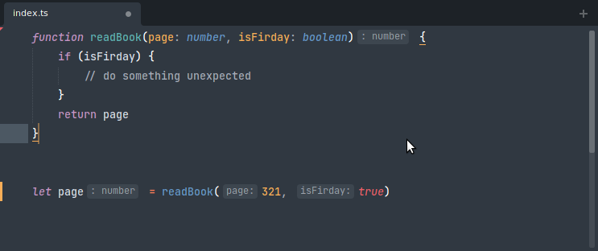

# LSP-vue

This is a helper package that automatically installs and updates the [Vue Language Server](https://github.com/vuejs/language-tools) (formerly Volar) for you.

## Table of Contents
  - [Installation](#installation)
  - [Configuration](#configuration)
  - [TypeScript support](#typescript-support)
  - [Known limitations](#known-limitations)
  - [Inlay hints](#inlay-hints)
  - [Vue 2 support](#vue-2-support)

### Installation

* Install from _Package Control_:
  - [LSP](https://packagecontrol.io/packages/LSP)
  - [Vue Syntax Highlight](https://packagecontrol.io/packages/Vue%20Syntax%20Highlight)
  - [LSP-vue](https://packagecontrol.io/packages/LSP-vue)
  - [LSP-tsgo](https://packagecontrol.io/packages/LSP-tsgo)
* Restart Sublime.

> [!NOTE]
> Make sure that `LSP-tsgo` is installed - it's a required dependency. `LSP-typescript` is no longer used for Vue files.

### Configuration

Open the configuration file using Command Palette with `Preferences: LSP-vue Settings` command or opening it from the Sublime menu (`Preferences > Package Settings > LSP > Servers > LSP-vue`).

### TypeScript support

TypeScript 7 type-checks Vue files through the `@vue/content-mapper` package, and `LSP-tsgo` provides the TypeScript features (diagnostics, hover, go to definition, references, rename) in them. The Vue language server asks `LSP-tsgo` about the project of each file.

1. Install TypeScript 7.1 or later and the content mapper in the project:

   ```sh
   npm i -D typescript@beta @vue/content-mapper@alpha
   ```

2. Add the content mapper to `tsconfig.json`. Vue compiler options, which were in `vueCompilerOptions` before, go in `options`:

   ```jsonc
   {
       "contentMappers": [
           {
               "package": "@vue/content-mapper",
               "extensions": [".vue"],
               "options": { "target": 3.5 }
           }
       ]
   }
   ```

`LSP-tsgo` runs content mappers by default. They run code from the project's `node_modules`, so you can disable them for projects that you don't trust with the `runExternalCode` setting of `LSP-tsgo`. Then Vue files get no TypeScript features.

Vue files outside any tsconfig use the content mapper that this package installs.

To type-check the project on the command line, use `tsc --runExternalCode` instead of `vue-tsc`.

> [!TIP]
> Install [LSP-file-watcher-chokidar](https://packagecontrol.io/packages/LSP-file-watcher-chokidar), so that the server sees changes to config files and components that are not open.

### Component colors

The server doesn't provide semantic tokens. Component tags get their color from the syntax.

### Known limitations

These are limitations of Vue Language Tools 4 and TypeScript 7.1, not of this package. See the [changelog](https://github.com/vuejs/language-tools/blob/master/CHANGELOG.md) of Vue Language Tools for the details.

- Formatting, folding, selection ranges, document symbols and JSX closing tags are not available in `<script>` blocks and template expressions.
- When you rename a name that a shorthand uses (`:count`, `:foo-bar`, `{ foo }`), the shorthand doesn't change. Renaming from the shorthand does nothing.
- Go to definition on an import of a Vue file through a `paths` alias (`import Foo from '@/Foo.vue'`) gives no result. A relative import works.
- An auto-import into an empty `<script setup>` or `<script>` of a component with a template goes into the template.

### Inlay hints

Inlay hints are short textual annotations that show parameter names, type hints.



To enable inlay hints:
1. Open the command palette and select `Preferences: LSP Settings`, then enable `show_inlay_hints`:
```js
{
    "show_inlay_hints": true
}
```

2. Modify the following settings through `Preferences: LSP-vue Settings`:

```js
{
  "settings": {
    // javascript inlay hints options.
    "javascript.inlayHints.enumMemberValues.enabled": false,
    "javascript.inlayHints.functionLikeReturnTypes.enabled": false,
    "javascript.inlayHints.parameterNames.enabled": "none",
    "javascript.inlayHints.parameterNames.suppressWhenArgumentMatchesName": false,
    "javascript.inlayHints.parameterTypes.enabled": false,
    "javascript.inlayHints.propertyDeclarationTypes.enabled": false,
    "javascript.inlayHints.variableTypes.enabled": false,
    // typescript inlay hints options.
    "typescript.inlayHints.enumMemberValues.enabled": false,
    "typescript.inlayHints.functionLikeReturnTypes.enabled": false,
    "typescript.inlayHints.parameterNames.enabled": "none",
    "typescript.inlayHints.parameterNames.suppressWhenArgumentMatchesName": false,
    "typescript.inlayHints.parameterTypes.enabled": false,
    "typescript.inlayHints.propertyDeclarationTypes.enabled": false,
    "typescript.inlayHints.variableTypes.enabled": false,
  }
}
```

> NOTE: Inlay hints require TypeScript 4.4+.
